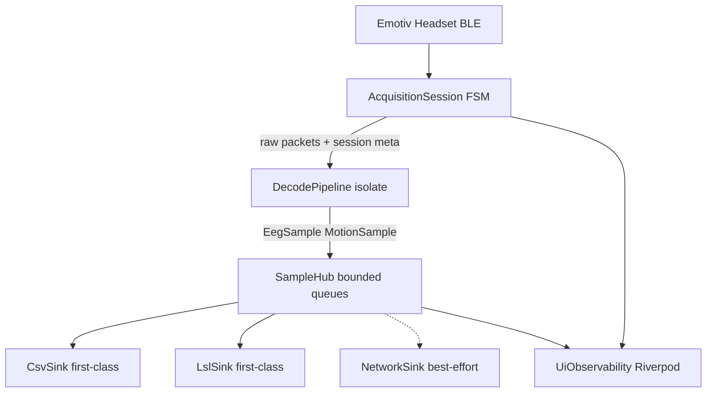
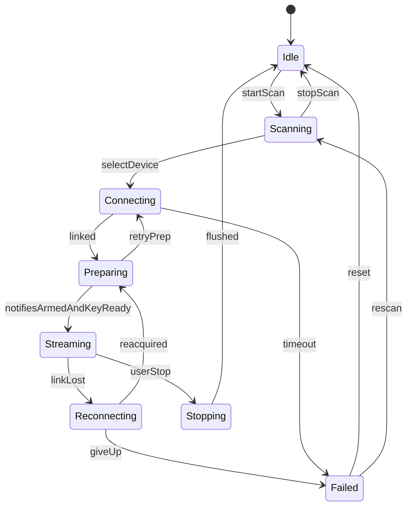

# Acquisition-first Flutter rewrite

## Decisions locked
- **Platform:** keep Flutter multi-platform (iOS / Android / desktop).
- **First-class sinks:** local CSV + raw packet log, and in-process LSL.
- **Not first-class:** network NDJSON (optional/best-effort; may lag or disconnect without affecting acquisition). UI is observational only.
- **No backwards compatibility** with current `EmotivBLEManager` APIs, settings schema, or file layout.

## Why rewrite (current failure modes)
Today almost everything lives in [`lib/emotiv_ble_manager.dart`](lib/emotiv_ble_manager.dart) + a monolithic [`lib/main.dart`](lib/main.dart):
- No reconnect FSM (auto-reconnect commented out).
- BLE `scanResults` / `connectionState` / notify listeners are never cancelled → duplicates on reconnect.
- File/LSL teardown is fire-and-forget → races with late packets.
- Crypto + disk + LSL + UI share one isolate and one god-object.
- LSL Android native load can fail; that must not stop recording.

## Target architecture

### Layering (replace `lib/`)

| Area | Responsibility |
|------|----------------|
| `lib/domain/` | Immutable models: `EegSample`, `MotionSample`, `RawPacket`, `SessionId`, sealed `AcquisitionState`, health metrics |
| `lib/acquisition/` | BLE scan/connect/notify via `flutter_blue_plus`; explicit FSM; key derivation; start-stream commands; reconnect |
| `lib/decode/` | AES EEG + motion parse (port of [`crypto_utils.dart`](lib/crypto_utils.dart)) on a dedicated isolate / compute worker |
| `lib/sinks/` | `CsvSink` (EEG/motion/raw), `LslSink` (`lsl_flutter` only), optional `NetworkSink` |
| `lib/app/` | Riverpod providers, thin Material UI (status, scan/connect, health, settings) |

Delete / stop using: god-object `EmotivBLEManager`, unused `FileStorage`, dual LSL (`liblsl` removed from production deps; keep only `lsl_flutter`), and the current catch-all UI in `main.dart`.

## Acquisition state machine (core guarantee)

Sealed states, single transition owner (no ad-hoc bool flags):

**Hard rules**
1. Only `Streaming` (and brief `Preparing`) may accept notify payloads into the decode pipeline.
2. Every BLE subscription is held in a `SessionSubscriptions` bag and cancelled on every exit from `Connecting`/`Preparing`/`Streaming`/`Reconnecting`.
3. Teardown is **awaited and ordered**: stop accepting packets → cancel notifies → flush/close CSV → close LSL → disconnect.
4. Reconnect uses exponential backoff with jitter; same bonded/named device preferred; key re-derived on each successful link.
5. Acquisition never `await`s network I/O. LSL push failures increment counters and may mark LSL degraded; they do not pause BLE.

## Sample path (reliability contract)

1. Notify callback enqueues **raw bytes + monotonic receive time** only (no decrypt on the BLE callback).
2. Decode isolate returns typed samples (14-ch EEG @ expected 128 Hz, 6-ch motion @ ~16 Hz) or a typed `DecodeError`.
3. `SampleHub` fans out via **bounded channels**:
   - CSV and LSL: sized for multi-second burst; block/backpressure decode before dropping if possible; if forced to drop, record `droppedSamples` in health and never silently continue.
   - Network (if enabled): drop-oldest; never backpressure acquisition.
   - UI: drop-oldest, throttled (~5–10 Hz).
4. Timestamps: store both `receiveMonoUs` and wall-clock for CSV/LSL; document that headset clock is not available over this BLE path.

## First-class sinks

**CSV / raw**
- One session directory per connect: `{saveDir}/session_{iso}/` with `eeg.csv`, `motion.csv`, `raw.csv`, `session.json` (device name, key fingerprint, start time, rates).
- Single writer isolate or mutexed sequential writer; flush on interval, on buffer threshold, and on every ordered teardown.
- Port buffering ideas from current writers; replace unsynchronized `List` + timer races with a clear ownership model.

**LSL**
- Keep `lsl_flutter` (`OutletWorker`) as the only in-app LSL stack; remove unused `liblsl` dependency.
- Create outlets during `Preparing` after key ready; destroy during ordered teardown.
- If outlet creation fails (e.g. Android `liblsl.so`), transition LSL subsystem to `Degraded` and continue CSV + acquisition. Surface this in UI health, do not fail the session.
- Stream names/rates stay compatible with existing tooling: `Epoc X` 14ch@128 EEG, `Epoc X Motion` 6ch@16.

**Network (best-effort)**
- Keep optional settings + `NetworkStreamer`-style NDJSON, but behind a non-blocking sink adapter.
- Not required for “session healthy”; reconnect of TCP is independent of BLE FSM.

## State intelligence (Riverpod)

- `acquisitionControllerProvider` exposes sealed `AcquisitionState` + `AcquisitionHealth` (packet rates, gap count, decrypt failures, LSL degraded, CSV path, reconnect attempt).
- UI rebuilds from providers only; no `setState` owning BLE.
- Settings via `AppSettings` rewritten for new schema (save dir, optional network, LSL enable flag).
- Lifecycle: `WidgetsBindingObserver` requests `AcquisitionSession.flush()` on pause/inactive.

## Crypto / device identity

- Port proven Epoc X key derivation + AES-ECB EEG decrypt from [`lib/crypto_utils.dart`](lib/crypto_utils.dart) into `lib/decode/` with unit tests against captured fixtures (from `EXTERNAL/` HCI/logs where available).
- Keep BLE-name hex key extraction for now, but isolate it behind `DeviceIdentityResolver` so a future GATT serial read can replace it without touching the FSM.
- Motion remains unencrypted int16 decode; validate lengths explicitly per characteristic.

## UI (thin)

Replace the 1k-line `main.dart` with:
- Home: acquisition state chip, health meters (EEG Hz, drops, LSL status), scan/connect, stop.
- Settings: save directory, LSL on/off, optional network.
- No live 14-channel table as a reliability dependency; optional throttled preview only.

Keep existing workspace action buttons / FVM pin; update README for new session layout and health semantics.

## Testing strategy

- Unit: FSM transitions (connect/lost/reconnect/teardown), crypto fixtures, hub drop policies.
- Widget: home shows Degraded LSL while Streaming continues.
- Manual: real-device run on status-bar-selected iPhone/iPad; verify CSV continuity across a forced disconnect/reconnect and LSL visibility in LabRecorder / `test_reciever.py` when LSL works.

## Implementation order

1. Scaffold `domain` + FSM + Riverpod shell (no BLE yet).
2. Port decode + fixture tests.
3. Implement BLE session + subscription bag + reconnect.
4. CSV sink + session directory.
5. LSL sink with Degraded path.
6. Thin UI + settings.
7. Optional network sink last.
8. Delete old manager/UI/deps; update README and workspace notes.

## Out of scope
- Native Swift rewrite / abandoning Flutter.
- EmotivPRO OCR or USB HID paths.
- Preserving old SharedPreferences keys or CSV filenames.