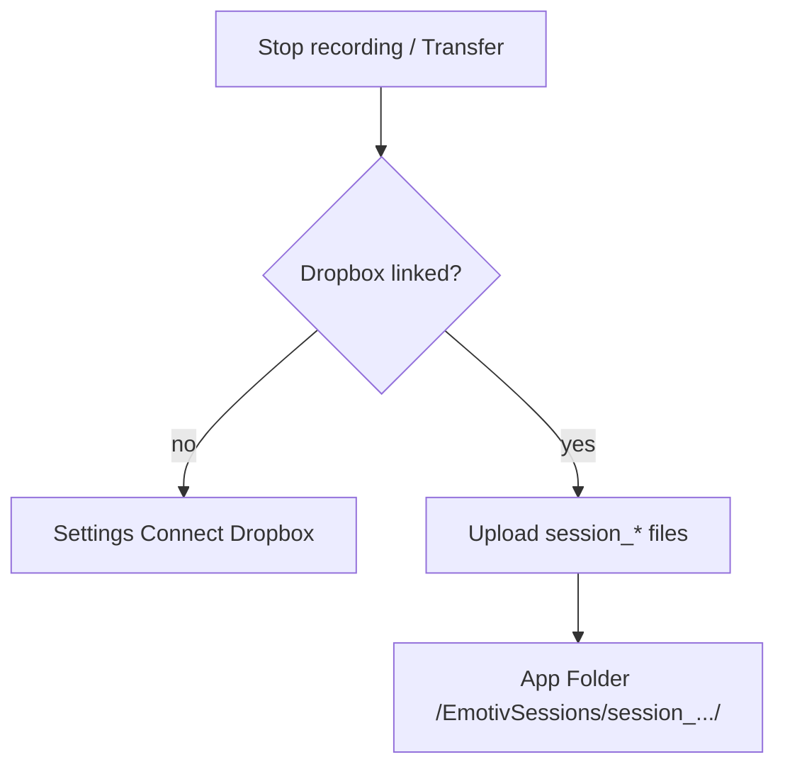

# Dropbox app sync (manual + auto)

## Decisions (locked)

- **Both**: Sessions can upload selected folders to Dropbox; optional **auto-upload** after a recording stops.
- **App Folder** scoped Dropbox app (not full Dropbox). Paths are under `Apps/<App name>/`.
- **PKCE** via [`dropbox_client`](https://pub.dev/packages/dropbox_client) — no app secret in the binary.
- You create the Dropbox app; the key is supplied at build time (`--dart-define=DROPBOX_APP_KEY=…`) and mirrored in iOS/Android URL schemes.



## 0. Dropbox App Console (you do once)

1. https://www.dropbox.com/developers/apps → **Create app**
2. API: **Scoped access**; type: **App folder**; name e.g. `Emotiv Logger`
3. Permissions: `files.content.write`, `files.content.read`, `files.metadata.write`, `files.metadata.read`
4. Copy **App key**
5. Build/run with:
   ```bash
   flutter run --dart-define=DROPBOX_APP_KEY=<key> --dart-define=DROPBOX_CLIENT_ID=emotiv-logger
   ```
6. Replace placeholder `YOUR_DROPBOX_APP_KEY` in iOS/Android URL scheme entries with the same key (`db-<key>`). Document this in README.

## 1. Dependency + config

- Add `dropbox_client: ^1.2.2`
- [`lib/sessions/dropbox_config.dart`](lib/sessions/dropbox_config.dart): `appKey` / `clientId` from `String.fromEnvironment`; `isConfigured` when key non-empty
- Init once in [`lib/main.dart`](lib/main.dart) when configured

## 2. Auth + upload service

New [`lib/sessions/dropbox_sync.dart`](lib/sessions/dropbox_sync.dart):

- `ensureAuthorized()` — restore PKCE credentials from secure storage, else `authorizePKCE()`, persist `getCredentials()`
- `unlink()`
- `uploadSession(localSessionDir, {remoteRoot, onProgress})` — create `/EmotivSessions/<folderName>/` under app folder and `Dropbox.upload` each file (reuse progress shape from [`TransferProgress`](lib/sessions/session_transfer.dart))
- Soft-fail if key missing (clear message to configure dart-define)

Store credentials via existing `flutter_secure_storage` (same pattern as [`BookmarkStore`](lib/sessions/bookmark_store.dart)).

## 3. Settings

Extend [`AppSettings`](lib/app/settings.dart):

- `dropboxAutoUpload` (bool, default false)
- `dropboxRemoteRoot` (String, default `EmotivSessions`)

[`SettingsPage`](lib/app/settings_page.dart):

- Connect / Disconnect Dropbox (show linked status)
- Auto-upload toggle (enabled only when linked)
- Remote folder field under app folder

## 4. Manual transfer (Sessions)

Update [`SessionsPage._transferSelected`](lib/app/sessions_page.dart):

- Destination chooser: existing SFTP/SMB bookmarks **or** Dropbox (if linked)
- If no bookmarks and Dropbox not linked → prompt to connect Dropbox or add bookmark
- Dropbox path runs `DropboxSync.uploadSession` with the same progress dialog

## 5. Auto-upload on stop

In [`AcquisitionSession`](lib/acquisition/acquisition_session.dart) after CSV flush in `_orderedTeardown` / user `stop()`:

- If `dropboxAutoUpload` and authorized and `csvSessionPath` set → fire-and-forget upload (do not block BLE teardown)
- Surface success/failure via a short status on health or snackbar through existing providers if easy; otherwise log + Settings last-error string

## 6. Platform wiring

- **iOS** [`ios/Runner/Info.plist`](ios/Runner/Info.plist): `LSApplicationQueriesSchemes` (`dbapi-8-emm`, `dbapi-2`); `CFBundleURLTypes` scheme `db-YOUR_DROPBOX_APP_KEY`
- **iOS** [`ios/Runner/AppDelegate.swift`](ios/Runner/AppDelegate.swift): `DBClientsManager.handleRedirectURL` (per dropbox_client docs; match Flutter scene delegate if present)
- **Android** [`AndroidManifest.xml`](android/app/src/main/AndroidManifest.xml): `AuthActivity` with `db-YOUR_DROPBOX_APP_KEY`
- README: Dropbox setup + dart-define + replace URL scheme placeholders

## Out of scope

- Full Dropbox (non–App Folder) access
- Download/sync-from-cloud into Sessions list
- Embedding an app secret
