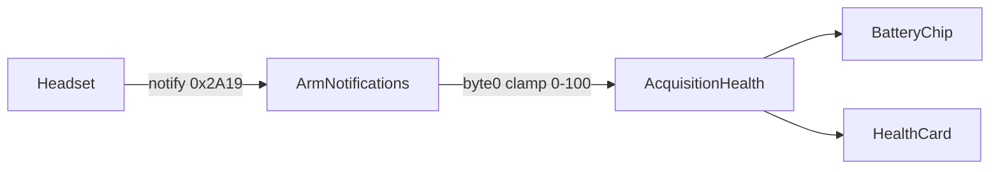

# Add Epoc X battery level indicator

## Source of truth

EmotivPRO Android routes battery as a **separate GATT notify**, not as an EEG field:

- Service `0x180F` / characteristic `00002A19-…`
- Payload: **1 byte = percent 0–100** (`flowBatteryData`)
- Documented in [`epocx-ble-protocol.md`](/Users/pho/repo/EmotivEpocRepos2025/OfficialEmotivSoftwareReverseEngineer/.specify/memory/epocx-ble-protocol.md) and already stubbed as [`EmotivBleUuids.batteryLevel`](lib/domain/ble_uuids.dart)

Do **not** parse Mode-7 EEG byte 0 / counter frames for SOC (those are legacy CyKit / USB paths; this app is BLE-only).

## Implementation

### 1. UUID helper

In [`lib/domain/ble_uuids.dart`](lib/domain/ble_uuids.dart):

- Add `isBatteryLevel(String uuid)` using the existing `_matches` helper (same pattern as `isMotion` / `isHeadsetConfig`).

### 2. Health model

In [`lib/domain/acquisition_health.dart`](lib/domain/acquisition_health.dart):

- Add nullable `int? batteryPercent`
- Wire through constructor + `copyWith` (with `clearBatteryPercent` so disconnect can reset it)

### 3. BLE subscribe in acquisition session

In [`lib/acquisition/acquisition_session.dart`](lib/acquisition/acquisition_session.dart) `_armNotifications`:

- While discovering characteristics, also capture the Battery Level char when `EmotivBleUuids.isBatteryLevel(id)`
- After EEG/motion notify setup:
  - `read()` once for an immediate value
  - `setNotifyValue(true)` and listen on `lastValueStream`
  - On each payload: if non-empty, `batteryPercent = data[0].clamp(0, 100)` via existing `_mutateHealth` / emit path
- Treat missing battery char as non-fatal (leave `batteryPercent` null; some firmwares may omit BAS)
- Clear `batteryPercent` on stop/idle/failure paths that already reset health fields

### 4. Record-tab UI

In [`lib/app/home_page.dart`](lib/app/home_page.dart):

- Replace the lone `_StateChip` row with a small row: state chip + **battery chip** when `health.batteryPercent != null`
- Battery chip: Material battery icon + `"NN%"`; color by level (e.g. ≥50 green, ≥20 orange, else red)
- Also add a `_metric('Battery', …)` in `_HealthCard` so the value is visible in the health wrap even if the chip is easy to miss

### 5. Light test coverage

- Unit-style assertion that a one-byte BAS payload maps to clamped percent (small helper or existing session/health test if present)
- Smoke: health card still builds with `batteryPercent: null` and with a set percent

## Out of scope

- Charging state (`0x2A1A` / `0x2A1B` not bound in EmotivPRO RE)
- CSV / LSL battery export
- Legacy USB/CyKit in-packet battery formulas
- Discrete EmotivPRO bar SVG assets — use Flutter icons to match the existing Record UI language
