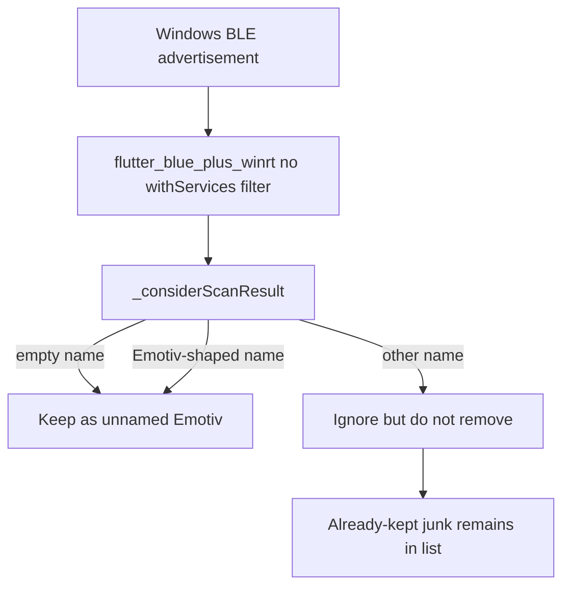

# Filter non-headset BLE devices on Windows

## Cause

Scan already requests Emotiv service UUIDs via `withServices` in [`lib/acquisition/acquisition_session.dart`](lib/acquisition/acquisition_session.dart), but **`flutter_blue_plus_winrt` does not apply that filter** — every BLE advertisement is delivered.

Client filter in `_considerScanResult` intentionally keeps **empty names** (Android often omits GAP name until later), assuming OS service filtering already ran:

```888:901:lib/acquisition/acquisition_session.dart
  void _considerScanResult(BluetoothDevice device, int rssi) {
    final name = device.platformName;
    ...
    // Keep service-filtered hits even when the local name is empty ...
    if (name.isNotEmpty && parsed == null && !isPreferred) {
      return;
    }
```

On Windows that lets junk through as `(unnamed Emotiv)`. Later name updates (e.g. `Vertuo_…`) hit `return` **without removing** the device from `_discovered`, so non-headsets stay in the list.



## Approach

Centralize “is this an Emotiv scan hit?” and require **name parse**, **preferred id/name**, or **advertised Emotiv service UUID**. Remove devices from `_discovered` when they no longer qualify.

### 1. Acceptance helper

Add a small pure helper next to existing parse logic in [`lib/decode/device_identity.dart`](lib/decode/device_identity.dart) (or a tiny sibling under `lib/domain/`), e.g. `isEmotivScanCandidate(name, serviceUuids, {isPreferred})`, using:

- [`DeviceIdentityResolver.tryParseAdvertisement`](lib/decode/device_identity.dart)
- [`EmotivBleUuids.control` / `serviceB`](lib/domain/ble_uuids.dart) against advertisement `serviceUuids`

### 2. Wire scan path to advertisement data

In [`lib/acquisition/acquisition_session.dart`](lib/acquisition/acquisition_session.dart):

- Change `_considerScanResult` to accept optional `List<Guid> serviceUuids` and prefer `platformName`, falling back to `advertisementData.advName` when empty.
- From both `FlutterBluePlus.scanResults` listeners (~line 173 and ~787), pass `r.advertisementData.serviceUuids` / `advName`.
- If not a candidate: **`_discovered.remove(id)`** (and rssi) so named junk cannot stick after an empty-name first sighting.
- `_seedAlreadyConnected` / `systemDevices`: only keep preferred or Emotiv-parseable names (no empty-name keep without service UUIDs).

Keep using `withServices: [control, serviceB]` for Android/iOS OS filtering; Windows relies on the Dart filter.

### 3. Tests

Extend [`test/crypto_codec_test.dart`](test/crypto_codec_test.dart) (or add a focused test file) for the helper:

- empty name + Emotiv service UUID → accept
- empty name + no services → reject
- `EPOCX E50202E9` → accept
- `Vertuo_DV6_…` / `Pixel Buds` → reject
- preferred id override → accept

## Out of scope

No WinRT plugin fork; no Dropbox/desktop auth changes.