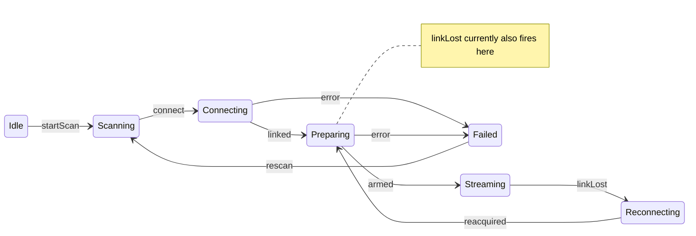

# Fix BLE scan/connect state machine

## Diagnosis

The pain (stop/start scan + power-cycle headset) lines up with bugs in [`lib/acquisition/acquisition_session.dart`](lib/acquisition/acquisition_session.dart), not with missing Emotiv GATT UUIDs.



### Root causes (highest impact first)

1. **Link-lost handler runs during Preparing/Connecting**  
   Connection listener is attached early in `_prepareAndStream`, and `_onLinkLost` only ignores `Idle` / `Failed` / `Stopping`. A disconnect (or a late/racey `disconnected` emission) during prepare tears down and starts reconnect **while prepare is still running** → overlapping connect/teardown, stuck Failed, or OS-held link that only a headset power cycle clears.

```274:279:lib/acquisition/acquisition_session.dart
      _subs.add(
        device.connectionState.listen((s) {
          if (s == BluetoothConnectionState.disconnected) {
            unawaited(_onLinkLost());
          }
        }),
      );
```

```558:564:lib/acquisition/acquisition_session.dart
  Future<void> _onLinkLost() async {
    if (_userStopRequested) return;
    if (_state is AcquisitionStopping ||
        _state is AcquisitionIdle ||
        _state is AcquisitionFailed) {
      return;
    }
```

2. **Failed connect does not always release the radio**  
   `_connectDevice` catch cancels subs and emits `Failed` but does **not** `disconnect()` the peripheral. A half-open OS connection stops advertising → next scan finds nothing until power cycle.

3. **`_stopScanRadio` cancels the whole session bag**  
   Comment says “scan-result listeners only”; code calls `_subs.cancelAll()`, which is the same bag used for connection + notify. Wrong bag ownership makes stop/connect/teardown brittle.

```772:780:lib/acquisition/acquisition_session.dart
  Future<void> _stopScanRadio() async {
    try {
      await FlutterBluePlus.stopScan();
    } catch (_) {}
    await _scanActiveSub?.cancel();
    _scanActiveSub = null;
    // Cancel scan-result listeners only; keep connection/notify subs intact.
    await _subs.cancelAll();
  }
```

4. **UI/state forces a cold rediscovery after failure**  
   Device list only renders for `AcquisitionScanning`. Connect failure → `Failed` (list hidden). Next Scan **clears** `_discovered` before hearing anything new. Auto-connect can also double-fire from concurrent `scanResults` events (`_autoConnectPreferred` cleared too late).

5. **Reconnect rediscovery is weak**  
   Link-lost recovery often reuses a stale `_device`, or scans for 2s of an 8s window with no `scanResults` listener. Preferred reconnect can also call `connect()` on a cached entry without ensuring the peripheral is advertising again.

## Approach

Keep the sealed states and Emotiv `withServices` filter (matches EmotivPRO / service `81072F40-…`). Fix ownership, guards, and failure recovery in `AcquisitionSession`, with small UI tweaks so a failed connect returns to a usable device list.

### 1. Split subscription ownership

In [`lib/acquisition/session_subscriptions.dart`](lib/acquisition/session_subscriptions.dart) (or inline in the session):

- `_scanSubs` — `scanResults` / scan-only listeners  
- `_linkSubs` — `connectionState` + characteristic notifies  

`_stopScanRadio` cancels **only** `_scanSubs` + `isScanning`. `_orderedTeardown` cancels `_linkSubs` (and scan subs if any).

### 2. Serialize connect / prepare / reconnect

Add a monotonic `_opEpoch` (or equivalent):

- Bump on `connect`, `disconnect`, `startScan`, failed exit, and each `_onLinkLost` entry  
- Every `await` path checks epoch before emitting or starting another connect  
- `_tryAutoConnectPreferred` sets a synchronous “claim” flag **before** any await so only one auto-connect runs  
- `connect()` no-ops if already `Connecting` / `Preparing` / `Streaming` / `Reconnecting`

### 3. Arm link-lost only after Streaming

- Move `connectionState` subscribe to **after** notifies are armed and state is about to become `Streaming`  
- `_onLinkLost` must also return unless state is `Streaming` or `Reconnecting` (never during `Connecting` / `Preparing`)  
- On connect/prepare failure: always `disconnect()` the peripheral, clear `_device`, cancel reconnect, then recover UI state (below)

### 4. Failure recovery keeps the device list

On connect/prepare failure (and optionally scan failure that still has prior devices):

- Emit `AcquisitionScanning(devices: …from _discovered, active: false, …)` instead of a dead-end `Failed` that hides the list  
- Or keep `Failed` but also show the last device list + “Scan again” without clearing cache until new results arrive  

Chosen default: **return to `Scanning(active: false)` with message in health / a banner**, so Connect/Reconnect remain one tap. Reserve `Failed` for adapter-off / unsupported / give-up-reconnect.

Change `startScan` so it does **not** wipe `_discovered` until the new scan actually starts producing results (or merge: clear only when first fresh callback arrives). Seed with `connectedDevices` and, where available, `FlutterBluePlus.systemDevices` for the preferred id so already-attached headsets appear without advertising.

### 5. Harden preferred reconnect

- `reconnectPreferred` / link-lost: if direct `connect` fails or device missing, run a short **listened** scan for preferred id/name (use full timeout, `scanResults` listener, then connect)—not a blind 2s sleep on `lastScanResults`  
- Disconnect before retry connect when a stale link may exist  
- Cap reconnect attempts as today; on give-up go to `Failed` with an explicit Reset → Idle

### 6. UI ([`lib/app/home_page.dart`](lib/app/home_page.dart))

- Keep showing `_DeviceList` whenever state is `AcquisitionScanning` (including after failed connect)  
- If we surface a soft error on scanning state, show a dismissible message above the list (reuse Failed card styling lightly)  
- Reconnect button: allow while `Scanning` even if `active` (already mostly true when inactive)

### 7. Tests

Add focused unit tests around a testable seam (extract pure helpers or inject a fake “radio” if easy; otherwise test state transition helpers):

- Link-lost ignored while Preparing  
- Auto-connect claims once  
- Connect failure → Scanning with prior devices, `_discovered` not emptied  
- `_stopScanRadio` does not clear link subscriptions  

No full `flutter_blue_plus` integration test required.

## Files to change

- [`lib/acquisition/acquisition_session.dart`](lib/acquisition/acquisition_session.dart) — main FSM fixes  
- [`lib/acquisition/session_subscriptions.dart`](lib/acquisition/session_subscriptions.dart) — split bags or dual instances  
- [`lib/domain/acquisition_state.dart`](lib/domain/acquisition_state.dart) — only if Scanning needs an optional `errorMessage`  
- [`lib/app/home_page.dart`](lib/app/home_page.dart) — device list / soft-error presentation  
- New/extended tests under `test/`

## Out of scope

- Changing Emotiv GATT UUIDs / decrypt path  
- Removing `withServices` scan filter (still correct per protocol)  
- Battery / LSL / CSV behavior  
