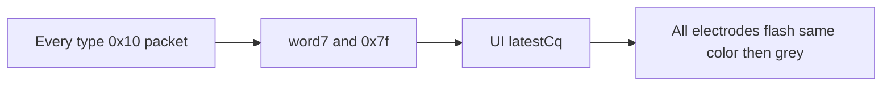

# Fix Mode-7 contact-quality flicker

## What’s wrong (matches your screenshots)

EEG traces are fine; CQ chip shows **`CQ 0 · None`**, head map stays all grey, and the CQ strip shows sparse **full-height** vertical color bars (red / orange / yellow / green) with mostly grey between them. The “14 electrode rows” are cosmetic separators on a **single broadcast** tier series — every column paints one color across the whole strip height. That pattern is ungated decode:



Android only accepts CQ on a **specific counter** ([`epocx-ble-protocol.md`](file:///Users/pho/repo/EmotivEpocRepos2025/ACTIVE_DEV/OfficialEmotivSoftwareReverseEngineer/.specify/memory/epocx-ble-protocol.md)):

> When `type == 0x10`: `CQ = w7 & 0x7f`, taken when `counter == *(decryptor+0xb0) - 1`.

At 128 Hz that is **`counter == 127`** (~1 Hz). Flutter currently sets CQ on every EEG frame in [`crypto_codec.dart`](lib/decode/crypto_codec.dart):

```205:205:lib/decode/crypto_codec.dart
      contactQuality: type == packetTypeEeg ? (word(7) & 0x7f) : null,
```

and forces zeros through [`decode_pipeline.dart`](lib/decode/decode_pipeline.dart) via `frame.contactQuality ?? 0`. Ungated packets carry junk/`0` in word7 → all electrodes flash one broadcast color (Mode-7 is a single RAW_CQ), then snap back to grey. pyPhoTimeline already treated `0` as “not computed yet” and **held last-good** ([`eeg_quality_gui_fixes_38b26e5f.plan.md`](file:///Users/pho/repo/EmotivEpocRepos2025/ACTIVE_DEV/pyPhoTimeline/.cursor/plans/eeg_quality_gui_fixes_38b26e5f.plan.md)).

**Note:** Mode-7 HID cannot produce different per-electrode colors; that needs Cortex `dev` / `DataOutputContactQuality`. Broadcast coloring is correct once gated; flicker is the bug.

## Fix approach

Sticky CQ in the decode path (Android CQ-cache style), gated at the codec:

1. **Gate in `CryptoCodec._frameFromPlaintext`**
   - Set `contactQuality` only when `type == 0x10` **and** `counter == sampleRateHz - 1` (default 128 → 127; also accept 255 for 256 Hz wraps already known by [`EegCounterMonitor`](lib/decode/eeg_counter_monitor.dart)).
   - Otherwise leave `contactQuality: null` (no update this package).

2. **Hold last valid CQ in `DecodePipeline`**
   - Session-local `_heldContactQuality` (reset on pipeline reset).
   - When `frame.contactQuality != null`, update hold (including legitimate gated `0` = no contact).
   - Emit `EegSample.contactQuality: _heldContactQuality` on every EEG sample so UI/LSL see a stable ~1 Hz CQ without grey flicker between gated packets.

3. **Tests**
   - Extend [`test/crypto_codec_test.dart`](test/crypto_codec_test.dart): CQ present only on gated counters; null on ungated `0x10` frames.
   - Extend [`test/decode_pipeline_test.dart`](test/decode_pipeline_test.dart): ungated packets keep previous CQ; gated update changes it; gated `0` clears hold; reset clears hold.
   - Keep existing ring/UI tests; add a small ring/UI assertion that a stream of `cq=0` after a good value no longer paints unknown if samples already carry held CQ from the pipeline (pipeline is the source of truth).

4. **Docs / UI copy (minimal)**
   - Comment on codec + tier docs: Mode-7 is broadcast RAW_CQ gated at `counter == rate-1`.
   - Optional one-line under the head map in [`home_page.dart`](lib/app/home_page.dart): “Mode-7: single headset CQ (all sensors)” so solid-color updates don’t look like a bug.

## Out of scope

- True per-electrode CQ (requires Cortex `dev` / Android `DataOutputContactQuality`).
- Changing emotiv-lsl / cpp clients (same gate omission today; Flutter-only fix for this app).

## Key files

- [`lib/decode/crypto_codec.dart`](lib/decode/crypto_codec.dart) — counter gate
- [`lib/decode/decode_pipeline.dart`](lib/decode/decode_pipeline.dart) — sticky held CQ
- [`test/crypto_codec_test.dart`](test/crypto_codec_test.dart), [`test/decode_pipeline_test.dart`](test/decode_pipeline_test.dart)
- Light copy/comment in [`lib/plot/contact_quality_tier.dart`](lib/plot/contact_quality_tier.dart) / [`lib/app/home_page.dart`](lib/app/home_page.dart)
