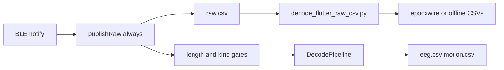

# Harden raw BLE capture + offline decode

## iOS answer (current behavior)

**Always on — no setting.** When streaming starts and `CsvSink.startSession` succeeds, `raw.csv` is created and every accepted notify is appended. There is no “enable raw” toggle.

On iOS specifically:

- Files go under the app **Documents** directory (`session_<iso>/raw.csv`). Custom save folders are forced off via [`save_directory_policy.dart`](lib/app/save_directory_policy.dart).
- Getting them off-device still uses Sessions transfer or live Dropbox/SMB sync (those destinations must be configured).
- Only failure mode: if CSV open throws, acquisition continues with `CSV unavailable: …` and **no** `raw.csv` for that run.

## Gaps vs your goal

Today, raw is mostly independent of decrypt, but not of packet handling:

- [`_enqueueRaw`](lib/acquisition/acquisition_session.dart) drops packets below EEG/motion min lengths **before** `publishRaw`.
- `kind` is assigned from the GATT characteristic, not from payload content.
- No characteristic UUID in `raw.csv`, so mis-mapped chars are hard to recover later.
- No first-party offline tool for the current `wall_ms,mono_us,kind,bytes` format.

## 1. Harden Flutter raw capture

Primary files: [`lib/domain/samples.dart`](lib/domain/samples.dart), [`lib/acquisition/acquisition_session.dart`](lib/acquisition/acquisition_session.dart), [`lib/sinks/csv_sink.dart`](lib/sinks/csv_sink.dart), [`lib/decode/decode_pipeline.dart`](lib/decode/decode_pipeline.dart), tests.

**Capture order (locked):**

```
notify bytes → always publishRaw → then length/kind gates for DecodePipeline only
```

- Add optional `characteristicUuid` (and keep advisory `PacketKind`) on `RawPacket`.
- Pass UUID from the EEG/motion notify listeners into `_enqueueRaw`.
- Always `publishRaw` for non-empty payloads after `_acceptPackets` is true; **do not** apply min-length filters to the raw path.
- Keep min-length / crypto gates only on `_decode.submit`.
- Extend `raw.csv` header to: `wall_ms,mono_us,kind,char_uuid,bytes` (space-separated decimal bytes unchanged for continuity with existing sessions).
- Enrich `session.json` with fields offline tools need without guessing: `serialSource: "ble_hex"`, `eegResolutionBits`, `btKeyHex` (already present).

No UI toggle: raw remains always-on whenever CSV session opens (same as today).

## 2. Offline decode / replay tooling

Add under emotiv-lsl (alongside existing wire tools):

- [`ACTIVE_DEV/emotiv-lsl/scripts/decode_flutter_raw_csv.py`](ACTIVE_DEV/emotiv-lsl/scripts/decode_flutter_raw_csv.py) — read a Flutter `session_*` folder (`session.json` + `raw.csv`), decrypt/decode with `EmotivEpocX` using `btKeyHex` / `serial_source=ble_hex`, write `eeg_offline.csv` / `motion_offline.csv`.
- Classification for offline decode: use payload length first (32 → EEG decrypt path, 20 → motion), treat CSV `kind` as advisory only; optionally try both when ambiguous.
- Converter to `.epocxwire` for `main.py --replay` (reuse [`emotiv_lsl/epocx_wire.py`](ACTIVE_DEV/emotiv-lsl/emotiv_lsl/epocx_wire.py) writer APIs), using `mono_us` deltas as `rel_ns`.
- Small unit test with a synthetic `raw.csv` + known ciphertext from existing decode tests.

## 3. Docs / health copy

- Update [`README.md`](README.md) Session files section for the new `raw.csv` columns and the offline script.
- Keep Health messaging that points at `raw.csv` when counters look wrong.


