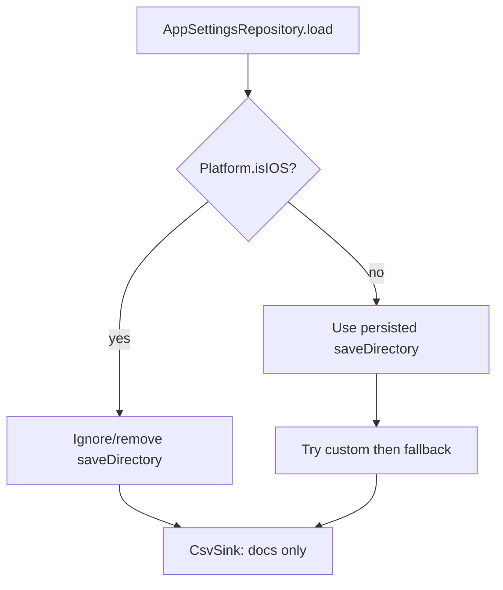

# iOS CSV: force app Documents

## Problem

Persisted `acq.v1.saveDirectory` holds a Files-app path like `…/File Provider Storage/EEG`. Without a security-scoped bookmark, [`CsvSink._probeWritable`](lib/sinks/csv_sink.dart) fails with `PathAccessException` / errno 1; fallback to Documents works but Health shows **CSV: Fallback** and an orange denied message. Sessions can still prefer the unwritable custom base via [`SessionLibrary.resolveBaseDirectory`](lib/sessions/session_library.dart).

## Approach (chosen)

**Reliable iOS default** — do not implement security-scoped bookmarks. On iOS, never persist or use custom picker paths; always use `getApplicationDocumentsDirectory()`. [`UIFileSharingEnabled`](ios/Runner/Info.plist) already exposes Documents in Files. Android keeps folder pick + current probe/fallback.

## Concrete changes

### 1. Clear and ignore custom path on iOS — [`lib/app/settings.dart`](lib/app/settings.dart)

In `AppSettingsRepository.load()`:
- If `Platform.isIOS` and `saveDirectory` is non-null, `prefs.remove(_saveDirectoryKey)` and return settings with `saveDirectory: null`.
- Ensures one launch removes the dead File Provider path for all users who already have it stored.

In `save()`:
- On iOS, always `prefs.remove(_saveDirectoryKey)` and treat `saveDirectory` as null (defense in depth if Apply still carries a draft).

### 2. Settings UX — [`lib/app/settings_page.dart`](lib/app/settings_page.dart)

- On iOS: remove Pick/Clear folder controls; show a fixed subtitle that recordings go to app Documents (visible in Files → On My iPhone → Flutter Emotiv Logger).
- On Android: keep existing pick/clear + note.

### 3. Directory helper — [`lib/directory_helper.dart`](lib/directory_helper.dart)

- Make `selectDirectory()` return `null` on iOS (or unused after UX change) so no accidental picker path can be stored.

### 4. Optional harden CSV start — [`lib/sinks/csv_sink.dart`](lib/sinks/csv_sink.dart)

- On iOS, ignore `saveDirectory` even if a non-null string is passed (treat as null before preferred-path try). Keeps acquisition/Sessions consistent if any caller still passes a stale value.

### 5. Tests

- Extend or add a small unit test that documents: when preferred path is ignored/null, `usedFallback` is false and message is the normal Documents path (not “custom path denied”).
- Keep existing [`test/csv_fallback_test.dart`](test/csv_fallback_test.dart) health fallback coverage for Android-style denied paths.

### Out of scope

- Security-scoped bookmarks / `dir_picker`
- Changing App Group entitlements (unused for this feature)
- Android save-directory behavior

## Verification

- Cold start with old prefs: no orange PathAccessException; **CSV: OK**; session under Documents.
- Settings on iOS: no folder picker; Apply does not reintroduce a custom path.
- Sessions lists Documents sessions; SFTP/SMB transfer unchanged.
- `flutter test` for touched tests.
