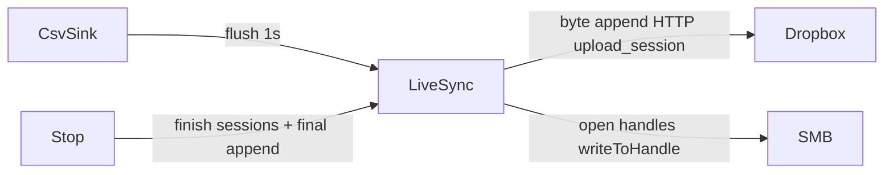

# Live Dropbox + SMB sync during recording

## Locked decisions

- **1B**: Sync **while recording** (incremental), not only after Stop.
- **2B**: **Dropbox and SMB** may both sync in parallel when configured.
- Manual Sessions → Transfer remains as a catch-up / re-upload path.
- SFTP is **out of scope** for live sync.

## Current state

- CSV writers open under `session_*` and flush every 1s ([`lib/sinks/csv_sink.dart`](lib/sinks/csv_sink.dart)).
- Dropbox: one-shot folder upload; optional post-Stop auto-upload default **off** ([`lib/sessions/dropbox_sync.dart`](lib/sessions/dropbox_sync.dart), [`dropboxAutoUpload`](lib/app/settings.dart)).
- SMB: manual upload via [`SessionTransfer._uploadSmb`](lib/sessions/session_transfer.dart); `dart_smb2` supports `openFileWrite` + `writeToHandle(offset:)` for true append.
- `dropbox_client` exposes only full-file `Dropbox.upload` — **no** upload-session append API.

## Approach

New coordinator [`lib/sessions/live_session_sync.dart`](lib/sessions/live_session_sync.dart):

1. **`start(sessionPath)`** when CSV session opens (from [`AcquisitionSession._prepareAndStream`](lib/acquisition/acquisition_session.dart)).
2. Periodic tick (~every 5s, after `CsvSink.flush()`): for each growing file (`eeg.csv`, `motion.csv`, `raw.csv`), push bytes since last synced offset. Upload `session.json` once at start.
3. Skip a tick if the previous tick is still running (never block BLE).
4. **`stop()`** on teardown: final flush + push remaining bytes + commit/close; best-effort, never throw into BLE teardown.

### Dropbox channel (incremental)

Add a thin HTTP helper (e.g. [`lib/sessions/dropbox_upload_session.dart`](lib/sessions/dropbox_upload_session.dart)) using the access token from `Dropbox.getAccessToken()` / credentials already managed by `DropboxSync`:

- Per file: `files/upload_session/start` → `append_v2` with new byte slices → on Stop `finish` with `mode: overwrite` into `/<remoteRoot>/<sessionFolder>/<file>`.
- Mid-recording: bytes leave the device continuously; committed Dropbox files appear after Stop (upload sessions are not readable until finish). Surface status like `Dropbox: live … (commits on Stop)`.
- Soft-fail if unlinked / missing key; keep local CSV as source of truth.

### SMB channel (incremental)

For each bookmark with `protocol == smb`, `liveSync == true`, and a remembered password:

- Connect pool once at start; `mkdir` remote session dir; `openFileWrite` per CSV (create, no truncate after first open).
- Each tick: read local `[offset, length)` and `writeToHandle` at that offset; advance offset.
- On stop: final append + `fsyncHandle` + `closeHandle` + disconnect.
- Reconnect/backoff on transient errors; report status without aborting acquisition.

### Settings / defaults (“relationship” as default)

In [`AppSettings`](lib/app/settings.dart) / [`SettingsPage`](lib/app/settings_page.dart):

- Replace the mental model of **Auto-upload after Stop** with **Live Dropbox sync** (`dropboxLiveSync`, default **`true`**). Migrate old `dropboxAutoUpload` key → new key; post-Stop finalize is part of live sync (no separate toggle).
- Keep Dropbox remote folder field.
- Add SMB: per-bookmark `liveSync` (default **`true`** for new SMB bookmarks) in [`ServerBookmark`](lib/sessions/server_bookmark.dart) + toggle in [`BookmarksPage`](lib/app/bookmarks_page.dart). Live sync only runs when password is remembered (required for unattended start).

Wiring in [`providers.dart`](lib/app/providers.dart): inject `LiveSessionSync` (DropboxSync + BookmarkStore password reads) into `AcquisitionSession`.

### UI status

Extend [`AcquisitionHealth`](lib/domain/acquisition_health.dart) with a short `syncMessage` (or reuse/generalize `dropboxMessage`) shown on the Record tab health card — e.g. `Sync: Dropbox live · SMB ok` / last error.

### Lifecycle hooks

In `_prepareAndStream` after successful `CsvSink.startSession`: `unawaited(liveSync.start(...))`.

In `_orderedTeardown` after `CsvSink.stop()`: `await liveSync.stop()` (bounded timeout) instead of today’s Dropbox-only `_autoUploadDropbox`.

On link-loss reconnect that opens a **new** `session_*` folder: stop prior live sync, start a new one for the new path.

## Out of scope

- Bidirectional / download sync
- Live SFTP sync
- Changing local CSV format or Documents policy
- Removing manual Sessions Transfer
