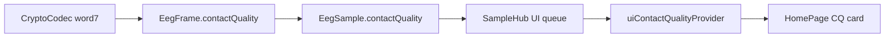

# Show decoded connection quality on Record

## Context

The Record tab’s “EEG preview” card in [`lib/app/home_page.dart`](lib/app/home_page.dart) currently prints the first six decoded µV values. Mode-7 contact quality is already defined in sibling `emotiv-lsl-cpp`: when `packetType == 0x10`, `cq = LE16 word[7] & 0x7f`, broadcast to all 14 channels. Flutter decrypts that package but **skips word 7** in [`CryptoCodec._frameFromPlaintext`](lib/decode/crypto_codec.dart).

## Approach

Carry a single CQ integer on the existing EEG path (no new sink queues, no LSL/CSV changes). Replace the µV preview with a contact-quality card.

### 1. Decode word 7

In [`lib/decode/crypto_codec.dart`](lib/decode/crypto_codec.dart):

- Add `int? contactQuality` on `EegFrame`.
- In `_frameFromPlaintext`, when `packetType == packetTypeEeg` (`0x10`), set `contactQuality: word(7) & 0x7f`; otherwise leave null (motion-type packages on the EEG characteristic stay skipped downstream).

### 2. Plumb through sample + pipeline

- Add `final int contactQuality` on [`EegSample`](lib/domain/samples.dart) (default `0` is fine for tests that construct samples without CQ).
- In [`decode_pipeline.dart`](lib/decode/decode_pipeline.dart), pass `frame.contactQuality ?? 0` into each `EegSample`.

`SampleHub` keeps publishing `EegSample` to `_uiEeg`; no hub API change required.

### 3. UI provider + Record card

- Rename/replace `uiEegPreviewProvider` in [`lib/app/providers.dart`](lib/app/providers.dart) with `uiContactQualityProvider` that yields `batch.last.contactQuality` (still throttled via `takeUiEeg(max: 1)`).
- In [`lib/app/home_page.dart`](lib/app/home_page.dart), replace the “EEG preview” card with **Connection quality**:
  - One large numeric readout `0–127` plus a short label from provisional bands: `0` none, `1–31` poor, `32–63` fair, `64–95` good, `96–127` excellent (color the chip accordingly).
  - A wrap of 14 labeled electrode chips (`EegSample.channelNames`) colored from that same value — matches Mode-7 “broadcast CQ” as in `emotiv-lsl-cpp`.

### 4. Tests

- Extend [`test/crypto_codec_test.dart`](test/crypto_codec_test.dart): assert `frame.contactQuality == words[7] & 0x7f` for a type-`0x10` package (keep the existing “word 7 is not an EEG channel” check).
- Adjust any widget smoke expectations that mention “EEG preview” if present.

## Out of scope

- LSL `eQuality` outlet, `cq.csv`, or battery (`0x2a19`).
- Per-channel CQ packing from older KeyModels (nibbles in bytes 16–22); this headset path is Mode-7 only.
