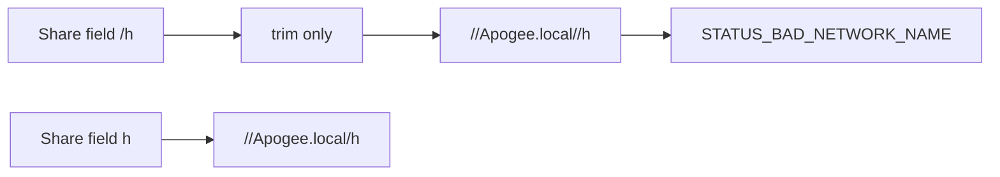

# Fix SMB share path + Bonjour browser

## Why it fails now

The form stores **SMB share** as `/h`. [`SessionTransfer._smbPool`](lib/sessions/session_transfer.dart) only `trim()`s the share and passes it to `Smb2Pool.connect`, so libsmb2 builds `//Apogee.local//h` and Tree Connect returns `STATUS_BAD_NETWORK_NAME` (`0xc00000cc`).

Remote *paths* already strip leading slashes (`_smbRemotePath`); **share names do not**. Typing `h` earlier would work; typing `/h` (or pasting a path-like value) fails on both iPad and Android. This is independent of the CSV Documents change.

## 1. Normalize SMB share names

Add `normalizeSmbShare(String raw)` (same idea as `_smbRemotePath`): strip whitespace, `\` → `/`, strip leading/trailing `/`, reject empty / path-looking multi-segment values with a clear error, keep only the share leaf (if input is `foo/bar` or `/foo`, use `foo`).

Apply in:
- [`SessionTransfer._smbPool`](lib/sessions/session_transfer.dart) before `Smb2Pool.connect`
- [`BookmarkEditorPage._draft`](lib/app/bookmarks_page.dart) when saving/testing so prefs store the clean name
- Optional: `ServerBookmark.fromJson` so existing bookmarks with `/h` heal on load

Unit-test normalization (`/h` → `h`, `\\h` → `h`, `h` → `h`).

## 2. Bonjour host browser + share selection

**Discovery:** add [`nsd`](https://pub.dev/packages/nsd) (native Bonjour/NSD; more reliable on iOS than pure `multicast_dns`). Browse `_smb._tcp` for ~5–10s.

**Share list:** use existing `Smb2Pool.listSharesOn(host:, user:, password:, domain:)` from `dart_smb2` (already a dependency). Show disk shares; hide `$`-suffixed admin shares by default.

**UI in** [`lib/app/bookmarks_page.dart`](lib/app/bookmarks_page.dart) (SMB mode only):
- **Browse LAN** — bottom sheet of discovered services; on tap fill `host` (prefer `.local` hostname), `port` (445 if missing), and `name` if empty.
- **List shares** — requires host + credentials; shows share names; on tap fills `smbShare`.
- Keep manual fields; browse is assistive, not required.

New small helper e.g. [`lib/sessions/smb_discovery.dart`](lib/sessions/smb_discovery.dart) wrapping `startDiscovery('_smb._tcp')` / stop and mapping to `{name, host, port}`.

## 3. Platform permissions

- **iOS** [`ios/Runner/Info.plist`](ios/Runner/Info.plist): add `NSBonjourServices` → `_smb._tcp` (keep existing `NSLocalNetworkUsageDescription`; multicast entitlement already present).
- **macOS** [`macos/Runner/Info.plist`](macos/Runner/Info.plist): same `NSBonjourServices` if missing.
- **Android**: `CHANGE_WIFI_MULTICAST_STATE` already present; no change unless analyzer requires more.

Update local-network usage string briefly to mention discovering SMB servers for transfer.

## 4. Tests / verify

- Unit tests for `normalizeSmbShare`.
- Manual: Test connection with share `h` (or a listed share) → Connection OK; Bonjour lists Apogee; List shares fills the field without leading `/`.

## Out of scope

- Changing SFTP bookmark flow
- Implementing a full file browser under the share (remote path stays free-text)
- CSV / save-directory work (already done)
